# 验证码组件

基于 PHP GD 的验证码，支持六种字体、1～9 级复杂度、噪点、单像素细曲线和按指定颜色识别的验证码。业务校验可忽略大小写。

## 安装与快速开始

需要 PHP 8.1+、GD 扩展及 FreeType 支持。

```bash
composer require easyswoole/verifycode:^4.0
```

```php
require 'vendor/autoload.php';

use EasySwoole\VerifyCode\{Config, VerifyCode, CaptchaColor, MIME};

$result = (new VerifyCode())->drawCode();
header('Content-Type: ' . $result->getImageMime());
echo $result->getImageByte();
```

默认随机生成 4 位数字及英文字母，随机选择字体和文字颜色，白色背景，开启噪点，关闭曲线，复杂度 1。

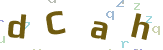

本文图片均由真实代码生成。字符、旋转、位置及干扰内容随机，每次运行会有所不同。

## 示例基础配置

后续示例共用此函数，以固定字体和配色比较不同配置。路径按本仓库根目录编写，安装到其他项目时请调整为组件目录中的绝对路径。

```php
function baseConfig(): Config
{
    return (new Config())
        ->setUseFont(__DIR__ . '/src/assets/ttf/6.ttf')
        ->setImageWidth(320)->setImageHeight(100)->setFontSize(30)
        ->setFontColor('#2457A6')->setBackColor('#FFFFFF')
        ->setUseNoise(false)->setUseCurve(false)->setComplexityLevel(1);
}

$result = (new VerifyCode(baseConfig()))->drawCode('AbC729');
```


`drawCode()` 不传内容时随机生成，传入字符串时按该内容绘制。内置字体只包含数字及大小写英文字母；当前生成和绘制按单字节字符处理。

## 字符集与长度

纯数字、随机生成 6 位：

```php
$config = baseConfig()->setCharset('0123456789')->setLength(6);
$result = (new VerifyCode($config))->drawCode();
```

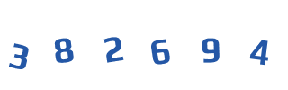

自定义字符集，排除易混字符：

```php
$config = baseConfig()
    ->setCharset('23456789ABCDEFGHJKLMNPQRSTUVWXYZ')->setLength(6);
$result = (new VerifyCode($config))->drawCode();
```


`setLength()` 只影响随机生成；显式内容以传入字符串的长度为准。

## 背景色与文字颜色

```php
$config = baseConfig()->setFontColor('#7A2E8E')->setBackColor([255, 249, 240]);
$result = (new VerifyCode($config))->drawCode('AbC729');
```

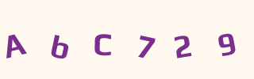

两个方法均支持三位或六位 HEX（可带 `#`）及 RGB 数组，如 `'#abc'`、`'2457A6'`、`[36, 87, 166]`。指定目标颜色时，目标字符颜色由枚举决定。

## 尺寸与字号

```php
$config = baseConfig()->setImageWidth(420)->setImageHeight(120)->setFontSize(38);
$result = (new VerifyCode($config))->drawCode('AbC729');
```

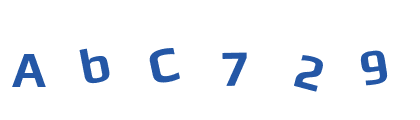

未指定宽高时根据字符数量和字号计算。显式尺寸不会自动扩张，较大字体和较高旋转幅度需要预留边距。

## 噪点和曲线

仅开启噪点：

```php
$config = baseConfig()->setUseNoise(true);
$result = (new VerifyCode($config))->drawCode('AbC729');
```

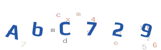

仅开启细曲线，所有干扰线均为 1 像素：

```php
$config = baseConfig()->setUseCurve(true)->setComplexityLevel(4);
$result = (new VerifyCode($config))->drawCode('AbC729');
```

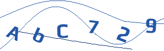

同时开启：

```php
$config = baseConfig()->setUseNoise(true)->setUseCurve(true)->setComplexityLevel(4);
$result = (new VerifyCode($config))->drawCode('AbC729');
```

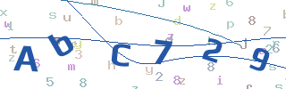

## 复杂度 1～9

```php
$config = baseConfig()->setComplexityLevel(5)->setUseNoise(true)->setUseCurve(true);
$result = (new VerifyCode($config))->drawCode('AbC729');
```

等级控制字符旋转、字号抖动、水平及上下位移，以及已开启的噪点和曲线数量。随机性会影响单张图片效果，复杂度尚未经过 OCR 成功率基准验证。

| 等级 | 实际效果 |
| --- | --- |
| 1 | 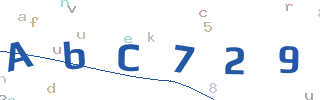 |
| 2 | 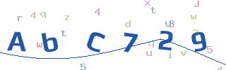 |
| 3 | 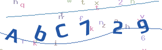 |
| 4 | 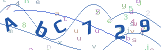 |
| 5 | 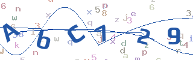 |
| 6 | 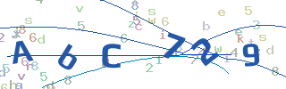 |
| 7 | 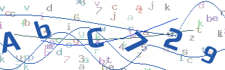 |
| 8 | 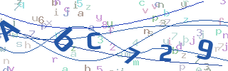 |
| 9 | 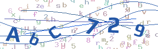 |

开关与等级独立，高等级不会自动开启噪点或曲线：

```php
$config = baseConfig()->setComplexityLevel(7)->setUseNoise(false)->setUseCurve(false);
$result = (new VerifyCode($config))->drawCode('AbC729');
```

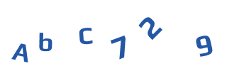

## 目标颜色与局部重叠干扰

```php
$config = baseConfig()->setComplexityLevel(3);
$result = (new VerifyCode($config))->drawCode('AbC729', CaptchaColor::BLUE);
$result->getPrompt();             // 请输入蓝色的验证码
$result->getTargetColor();        // CaptchaColor::BLUE
$result->getTargetColor()->value; // blue
$result->getTargetColor()->label();// 蓝色
```

前端显示提示语，用户从左到右输入目标颜色的字符。随机内容用 `drawCode(null, CaptchaColor::BLUE)`；不传颜色或传 `null` 时为普通模式，无彩色干扰。

| 目标枚举 | 提示 | 实际效果 |
| --- | --- | --- |
| `CaptchaColor::RED` | 请输入红色的验证码 | 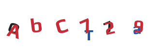 |
| `CaptchaColor::BLUE` | 请输入蓝色的验证码 | 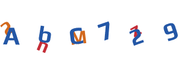 |
| `CaptchaColor::GREEN` | 请输入绿色的验证码 | 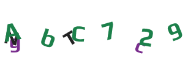 |
| `CaptchaColor::PURPLE` | 请输入紫色的验证码 | 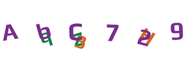 |
| `CaptchaColor::ORANGE` | 请输入橙色的验证码 | 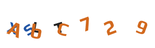 |
| `CaptchaColor::BLACK` | 请输入黑色的验证码 | 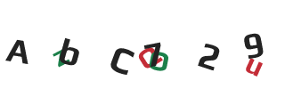 |

目标内容均为 `AbC729`。彩色干扰与噪点、曲线开关独立。每个目标色有预选干扰色集合，避开部分近似色组合，但不能保证所有色觉差异用户均可辨认，可提供普通模式作为替代。

减少重叠干扰数量：

```php
$config = baseConfig()->setComplexityLevel(3)
    ->setDecoyCodeCount(1)       // 组数 1～5，默认 2
    ->setDecoyCharacterCount(1); // 每组字符数 1～8，默认 2
$result = (new VerifyCode($config))->drawCode('AbC729', CaptchaColor::BLUE);
```

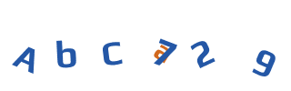

每组字符数量上限为目标长度。组内随机选择不同目标位置，组间可重复。目标字符最后绘制，局部重叠程度由随机位置和旋转决定。

## 字体

**未通过 `setUseFont()` 指定字体文件时，默认使用本包自带的 6 个字体，每个生成器实例从中随机选择一个。无需安装系统字体或额外下载字体。** 内置字体使用固定映射，选中的字体用于该实例后续生成的图片。也可以指定字体文件的绝对路径：

```php
$config = baseConfig()->setUseFont(__DIR__ . '/src/assets/ttf/1.ttf');
$result = (new VerifyCode($config))->drawCode('AbC729');
```

| 文件 | 字体来源 | 实际效果 |
| --- | --- | --- |
| `1.ttf` | Black Ops One | 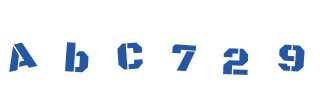 |
| `2.ttf` | Bungee |  |
| `3.ttf` | Monoton | 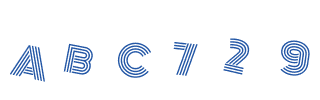 |
| `4.ttf` | Wallpoet |  |
| `5.ttf` | Jolly Lodger | 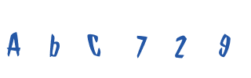 |
| `6.ttf` | Play Bold | 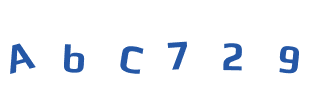 |

字体均裁剪为 62 个数字及英文字母，并重命名内部名称。部分字体大小写外观相同，业务按下方示例忽略大小写。来源与 SIL OFL 1.1 许可证见 [字体说明](src/assets/ttf/FONT-LICENSES.md)。

添加自有字体到随机字体池：

```php
$config = (new Config())->addFonts('/absolute/path/my-font.ttf');
$config->addFonts(['/absolute/path/another-font.ttf']);
$result = (new VerifyCode($config))->drawCode();
```

自有字体与内置字体一起参与选择。指定 `setUseFont()` 后直接使用指定字体。字体实际外观取决于提供的文件，上表展示了更换字体的差异。

## 图片格式

```php
$config = baseConfig()->setMimeType(MIME::JPG); // PNG / GIF / JPG
$result = (new VerifyCode($config))->drawCode('AbC729');
```

| 格式 | 实际效果 |
| --- | --- |
| `MIME::PNG`（默认） | 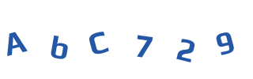 |
| `MIME::GIF`（静态） | 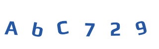 |
| `MIME::JPG` | 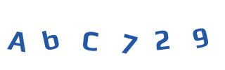 |

## 结果与输出

```php
$result->getImageByte();   // 二进制图片
$result->getImageBase64(); // 完整 data URI
$result->getImageMime();   // 图片 MIME
$result->getImageCode();   // 目标答案，仅保存在服务端
$result->getCreateTime();  // Unix 时间戳
$result->getTargetColor(); // 枚举，普通模式为 null
$result->getPrompt();      // 提示语，普通模式为 null
```

Base64 和二进制输出外观相同，可直接显示在前端：

```php
echo 'getImageBase64() . '">';
```

EasySwoole 控制器输出：

```php
$this->response()->withHeader('Content-Type', $result->getImageMime());
$this->response()->withHeader('Cache-Control', 'no-store');
$this->response()->write($result->getImageByte());
```

## 忽略大小写校验

组件负责生成图片和答案，业务负责保存与校验。以下示例使用 PHP Session，答案忽略大小写，120 秒有效，校验一次后失效。

生成请求：

```php
session_start();
$result = (new VerifyCode())->drawCode();
$_SESSION['captcha'] = [
    'code' => strtolower($result->getImageCode()),
    'expiresAt' => time() + 120,
];
header('Content-Type: ' . $result->getImageMime());
header('Cache-Control: no-store');
echo $result->getImageByte();
```

校验请求：

```php
session_start();
$saved = $_SESSION['captcha'] ?? null;
unset($_SESSION['captcha']);
$input = $_POST['captcha'] ?? null;
$valid = is_array($saved)
    && $saved['expiresAt'] >= time()
    && is_string($input)
    && hash_equals($saved['code'], strtolower(trim($input)));
```

EasySwoole 中请替换为业务自己的 Session 或 Redis 存储。前端仅接收图片和提示语，不接收答案，并配合请求限流。

`getCodeHash()` 保留旧版 MD5 摘要行为，默认区分大小写，不能替代带有效期的服务端答案存储。

## 测试和生成示例

```bash
composer install
composer test
php example/generate.php
```

`example/generate.php` 会覆盖生成本文引用的全部样例图片。生成脚本使用与 README 相同的配置，随机效果每次会有所不同。
